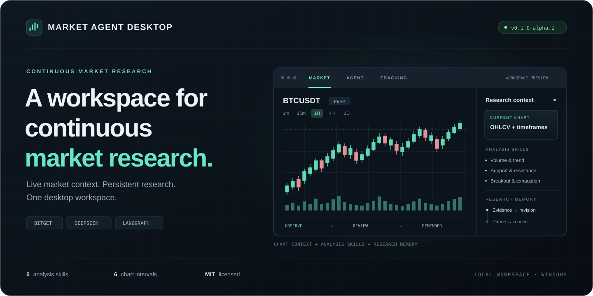
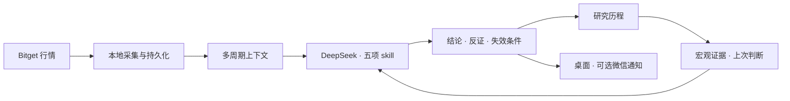

<div align="center">



### 看行情，也记住判断为什么改变。

基于 **DeepSeek Harness + LangGraph** 的 Windows 市场研究终端。<br>
将 Bitget 行情、图表对话、量价分析与长期追踪放进同一个工作台。

[](https://github.com/W0nderShy/market-agent-desktop/releases)
[](https://github.com/W0nderShy/market-agent-desktop/actions/workflows/check.yml)
[](LICENSE)


[快速开始](#快速开始) · [功能一览](#功能一览) · [使用指南](docs/USAGE.md) · [追踪框架](docs/architecture/LONG_TERM_FRAMEWORK_ANALYSIS.md) · [版本发布](https://github.com/W0nderShy/market-agent-desktop/releases)

</div>

---

## 一个工作台，串起行情与研究

打开图表，Agent 就能获取当前标的、周期和已加载的 K 线。开启追踪后，研究任务持续观察证据变化，保留上一轮判断，在需要复核时再次研究，并记录结论如何修订。

<table>
<tr>
<td width="33%" valign="top">

### ◉ 市场终端

Bitget 公开行情、多周期 K 线与成交量。按成交额、热度或自选浏览品种，在同一窗口切换市场与研究。

</td>
<td width="33%" valign="top">

### ◇ 图表对话

DeepSeek Agent 自动获取当前图表上下文。直接询问量价变化，结合 dsh 工具与五项分析 skill 展开研究。

</td>
<td width="33%" valign="top">

### ↻ 持续追踪

以行情变化与复核时间唤醒研究，维护证据、反证与失效条件。支持暂停、恢复和中断行情回补。

</td>
</tr>
<tr>
<td valign="top">

### ≋ 研究历程

结论和下一步建议优先展示，详细依据按需展开。历史修订保存在本地，追踪不只留下最新一段回答。

</td>
<td valign="top">

### ▤ 量化参考

BUY / HOLD / SELL 三项历史条件占比随已收盘 K 线更新，同时展示观察窗口、样本量与证据边界。

</td>
<td valign="top">

### ↗ 微信挂载

可选接入腾讯官方 ClawBot。通过个人微信查看状态、补充研究方向，并接收满足条件的研究更新。

</td>
</tr>
</table>

## 快速开始

> [!NOTE]
> 当前为 **Windows 源码预览版**。首次安装需要联网构建；`Trading_Terminal.exe` 是安装完成后的便捷启动入口。

**准备环境**

| 系统 | Python | Node.js | 其他工具 |
| :--- | :--- | :--- | :--- |
| Windows x64 | 3.12 | 24 | Git、pnpm 11 |

**1 · 获取完整源码**

```powershell
git clone --recurse-submodules https://github.com/W0nderShy/market-agent-desktop.git
cd market-agent-desktop
```

**2 · 安装并构建**

```powershell
powershell -NoProfile -ExecutionPolicy Bypass -File scripts/setup.ps1
powershell -NoProfile -ExecutionPolicy Bypass -File scripts/build-launcher.ps1
```

**3 · 打开工作台**

双击工程目录里的 **`Trading_Terminal.exe`**。进入行情终端后添加自选，在 **Agent** 面板配置自己的 DeepSeek 密钥，即可开始图表对话；在 **持续跟踪** 窗口选择标的并开启研究任务。

<details>
<summary><strong>已有源码、停止后台与安装排查</strong></summary>

已克隆但缺少 dsh 源码时，在工程根目录运行：

```powershell
git submodule update --init --recursive
```

GitHub 自动生成的 **Source code** 压缩包不包含 submodule 源码，建议使用递归克隆。首次安装会下载 Python、Node 依赖及 Electron，构建需要数分钟。

关闭桌面窗口后，后台采集服务可能仍在运行。需要完整退出或备份数据库时，先运行：

```powershell
powershell -NoProfile -File scripts/stop.ps1
```

更多安装步骤、服务管理与故障排查见 [安装与使用指南](docs/USAGE.md)。

</details>

## 功能一览

| 能力 | 当前实现 |
| :--- | :--- |
| **行情数据** | Bitget 公开接口；现货与接口实际支持的合约品种；行情时间与本地采集时间分别保留 |
| **图表周期** | `1m` · `5m` · `15m` · `1H` · `4H` · `1D`，展示真实 OHLCV |
| **Agent 上下文** | 当前标的、周期、最多 300 根已加载 K 线，以及时间与未收盘标记 |
| **分析 skill** | 成交量、趋势结构、支撑阻力、突破确认、动能衰竭 |
| **追踪记忆** | SQLite 持久化、研究历史、判断修订、断点恢复与行情回补 |
| **补充证据** | 多周期行情、已接入的 FRED 宏观序列与 Bitget 跨资产合约代理 |
| **微信通知** | 官方 iLink 协议、扫码连接、状态查询、研究方向输入与通知去重 |

<details>
<summary><strong>数据、研究与运行边界</strong></summary>

- **Bitget 行情无需 API Key。** 本项目使用公开市场接口，不读取交易账户，也不执行交易。
- **模型由用户配置。** 启用 Agent 或长期研究后，必要的消息、行情上下文和研究证据会发送至所配置的模型服务。
- **比例有明确口径。** BUY / HOLD / SELL 是历史相似条件的涨、震荡、跌占比，三项合计 100%；它们不是实盘策略胜率或已校准的未来概率。
- **研究允许证据不足。** 当前基本面、估值与链上等数据覆盖仍有限，缺口会限制长期阶段判断。
- **运行依赖电脑在线。** 休眠、关机或桌面研究进程退出期间不能持续研究；恢复后按断点处理。当前没有云端托管、开机自启或系统托盘。
- **微信存在会话时效。** 主动通知受官方接口的上下文限制；完整行为见 [微信挂载说明](docs/USAGE.md#个人微信挂载腾讯官方-clawbot)。

</details>

## 从一根 K 线，到持续维护的判断



采集持续进行；研究由证据变化与复核时间触发。完整设计与当前实现边界见 [长期资产追踪](docs/architecture/LONG_TERM_TRACKING.md)。

## 文档与开发

| 文档 | 内容 |
| :--- | :--- |
| [安装与使用指南](docs/USAGE.md) | 模型配置、图表上下文、分析 skill、微信挂载与故障排查 |
| [长期资产追踪](docs/architecture/LONG_TERM_TRACKING.md) | 采样、唤醒、研究记忆及数据覆盖边界 |
| [分析框架图与解读](docs/architecture/LONG_TERM_FRAMEWORK_ANALYSIS.md) | 长期研究框架与 SVG 图 |
| [数据隐私](docs/DATA_PRIVACY.md) | 凭据、运行数据、外部传输与公开发布要求 |

本地检查：

```powershell
.venv/Scripts/python.exe -m pytest -q
npm ci --prefix desktop --ignore-scripts
npm test --prefix desktop
python scripts/check-privacy.py
```

问题反馈与改进建议欢迎提交到 [Issues](https://github.com/W0nderShy/market-agent-desktop/issues)。请使用合成示例，避免附上密钥、完整会话或未经脱敏的运行日志。

## 隐私与许可

`runtime/` 和 `config/private/` 保存本机凭据、会话、研究记录与个人配置，并被 Git 忽略。公开仓库与 Release 不包含这些个人运行数据。云模型调用仍会发送完成研究所需的上下文；具体存储与权限边界见 [数据隐私说明](docs/DATA_PRIVACY.md)。

本项目自有代码采用 [MIT 许可](LICENSE)。感谢 [DeepSeek Harness](https://github.com/deepseek-ai/deepseek-harness)、[LangGraph](https://github.com/langchain-ai/langgraph) 与 [Bitget](https://www.bitget.com/docs/catalog/market/market-data)；`vendor/market-skills` 保留其 [上游来源](vendor/market-skills/UPSTREAM.json) 与 [MIT 许可证](vendor/market-skills/LICENSE)。

---

<div align="center">
<sub>Market Agent Desktop · 行情有上下文，研究有来路。</sub>
</div>
