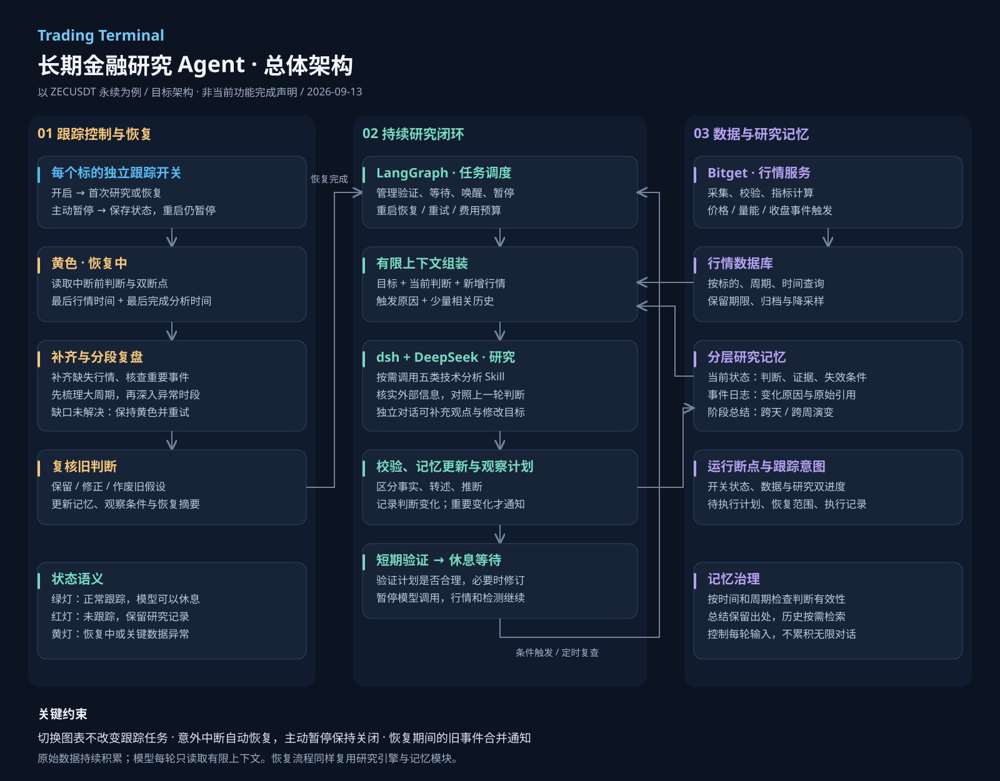

# 长期金融研究 Agent：ZEC 跟踪架构

更新日期：2026-09-13
状态：目标设计。本文不代表所列长期运行能力已实现。

## 1. 产品目标

用户在 ZECUSDT 永续旁打开跟踪开关，即可启动独立、可恢复的量价研究任务，不必在聊天中说“追踪”。任务持续观察行情，按条件唤醒研究，记住此前判断，并解释判断发生变化的原因。切换当前图表不影响后台任务。

当前已具备桌面行情、DeepSeek 对话、图表上下文、五类技术分析 Skill 和本地采集基础。本文新增的持久任务闭环、恢复复盘、研究记忆治理与通知策略仍需实现和验证。

## 2. 三种状态灯

| 状态 | 含义 | 模型是否运行 |
|---|---|---|
| 绿色：正常跟踪 | 行情和条件检测正常，研究任务有效 | 按需运行；等待时不调用模型 |
| 红色：未跟踪 | 用户主动暂停，已有记忆和断点保留 | 不执行该任务的自动研究 |
| 黄色：恢复中或异常 | 正在补齐中断信息，或关键数据不可用 | 允许恢复研究，不能假装正常跟踪 |

状态灯由任务健康状态决定，不能只依据网络连接或模型是否正在输出。暂停只停止该任务；其他任务仍需要的共享行情采集可以继续。

## 3. 正常研究闭环

1. **首次研究**：读取任务所需历史行情，核验时间与完整性，建立初始判断和证据。
2. **制定计划**：保存关键价位、量能条件、定时复查时间及判断失效条件。第一版使用可校验的结构化规则。
3. **持续验证**：在限定观察期内复核后续已收盘 K 线，检查观察计划是否合理，必要时修订。不是无间断调用模型。
4. **休息等待**：模型停止调用；行情采集、规则检测和调度继续运行。
5. **事件唤醒**：价格越界、异常量能、收盘或定时复查触发研究；先去重、冷却与合并，避免频繁重复调用。
6. **对照研究**：读取上轮判断，说明新证据加强、削弱或推翻了什么。
7. **更新与通知**：记录研究变化和下一步计划；仅在重要变化、故障或需要用户决策时通知。

五类 Skill 为成交量、趋势、支撑阻力、突破确认和动能衰竭。研究引擎按问题选择工具，不要求每次机械复述全部结果。新闻和外部事件按需检索，不替换 Bitget 行情源。

## 4. 恢复机制

### 主动暂停与意外中断

- 主动暂停：持久保存关闭意图；重启软件后保持红灯，直到用户重新打开。
- 意外断线或软件退出：保留开启意图；恢复后先亮黄灯，完成补齐和复核后再转绿。
- 首次开启：没有历史断点，执行初始研究。

### 双断点

同时记录最后有效行情时间和最后成功完成研究的覆盖时间。行情采集成功不代表模型已分析；恢复必须覆盖尚未研究的区间，不能只从最后采集时间开始。

### 恢复步骤

读取旧判断与断点 → 确定缺口 → 补齐行情与相关事件 → 分段复盘 → 复核旧判断 → 更新记忆和观察计划 → 转入正常跟踪。

长时间中断采用较大周期概览，再深入异常时段，不把所有历史一次塞进模型。重点关注中断期间曾发生但已回撤的突破、放量与结构变化。新闻不能补齐时明确标注来源和缺口；关键行情缺失时保持黄色并重试。预算不足或长期失败应提示用户，不无限重试消耗费用。

历史触发事件用于恢复复盘，合并为一份恢复摘要，不逐条发送过时提醒。

## 5. 记忆与上下文

| 层次 | 内容 | 读取方式 |
|---|---|---|
| 行情数据库 | 原始 OHLCV、衍生指标 | 按标的、周期和时间查询 |
| 当前研究状态 | 最新判断、证据、假设、失效条件 | 每次唤醒优先加载 |
| 研究事件日志 | 触发原因、结论变化、证据引用 | 需要复盘时检索 |
| 阶段总结 | 跨天、跨周的演变 | 跨阶段研究时加载 |
| 运行断点 | 跟踪意图、双进度、待执行计划 | 调度、暂停和恢复时使用 |

每轮上下文由“任务目标 + 当前状态 + 新增行情 + 触发原因 + 少量相关历史”组成，并设输入预算。判断必须带标的、周期、时间和失效条件。事实、外部转述和模型推断分别记录。

总结保留原始证据引用，不能把旧推断升级为事实。行情按保留期限归档或降采样；重要研究事件保留，重复运行日志定期清理。具体保留期限与费用上限应作为配置项，在实现阶段确定。

## 6. 模块职责

| 模块 | 职责 |
|---|---|
| 桌面终端 | 跟踪开关、状态灯、当前判断、观察计划、恢复进度和通知 |
| Bitget 行情服务 | 独立采集任务所需数据，校验、补齐并计算指标 |
| LangGraph | 状态迁移、验证与等待、唤醒、暂停、重试和恢复 |
| dsh + DeepSeek | Skill 调用、必要搜索、证据权衡、判断修订与对话 |
| 上下文组装器 | 按相关性和预算加载数据，排除失效或不匹配记忆 |
| 持久存储 | 保存任务、研究状态、事件、计划、断点及执行结果 |

对话通道独立于自动研究。用户的新观点作为有来源的输入事件进入任务，不能直接覆盖已核实事实。任务配置和研究状态采用版本检查或串行提交，避免对话与后台研究同时覆盖更新。

## 7. 长期运行保障

- 每轮研究和触发事件具有唯一标识；重试不能产生重复提交或重复通知。
- 成功保存研究结果和计划后再推进研究断点；失败不伪装成已处理。
- 限制调用费用、单轮时长、重试次数和唤醒频率。
- 暂停期间到达的旧执行结果不能重新激活任务；恢复流程提交前再次核对用户开关状态。
- 可追溯每轮使用的数据范围、工具、结论变化及错误，但不记录或发布密钥。
- 电脑休眠或关机期间不承诺实际执行；再次启动后通过恢复机制补齐。真正全天候运行需要持续在线的运行环境。

## 8. 第一版验收

1. 打开 ZEC 开关，完成初始研究并显示绿灯。
2. 验证期结束后进入等待，模型调用停止而行情检测继续。
3. 条件触发后完成新研究，能解释与上轮判断的差异。
4. 切换到其他图表，ZEC 任务继续独立运行。
5. 主动暂停后重启仍为红灯。
6. 开启状态下意外中断，重启先黄灯，补齐和复核后转绿。
7. 恢复能够发现“中间突破后又回撤”等仅看最新价格会遗漏的过程。
8. 长期运行的单轮上下文受控；历史判断与证据仍可追溯。

## 9. 文件

- `ZEC_TRACKING_ARCHITECTURE.md`：架构与行为说明。
- `zec-tracking-architecture.svg`：可缩放矢量图，适合放大和导出。
